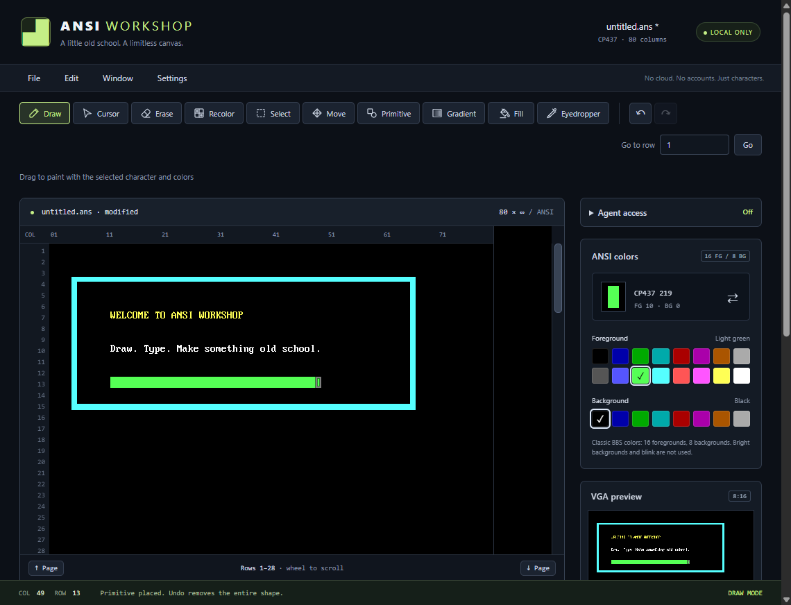
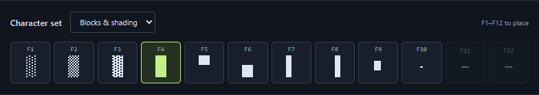
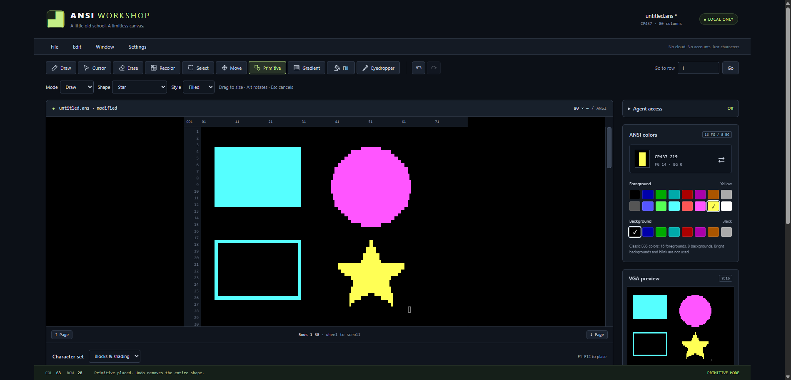
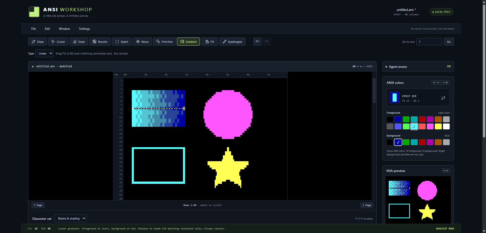
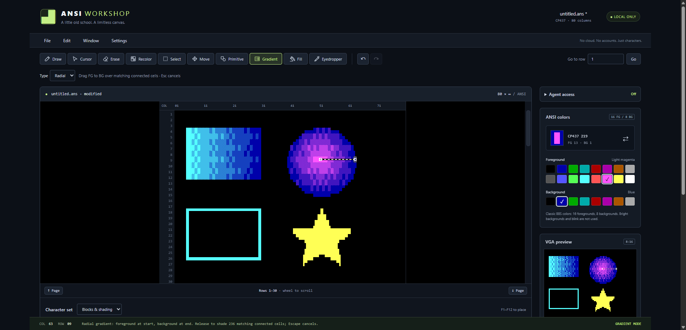
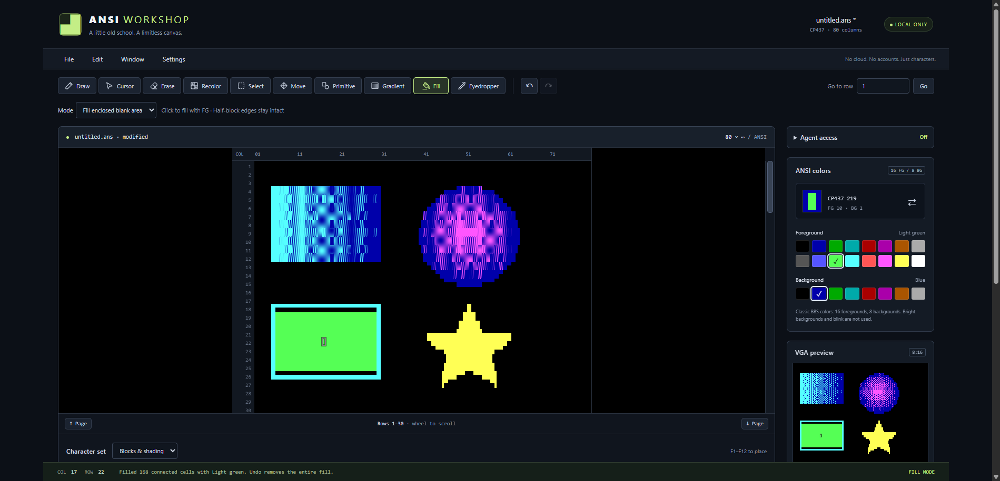
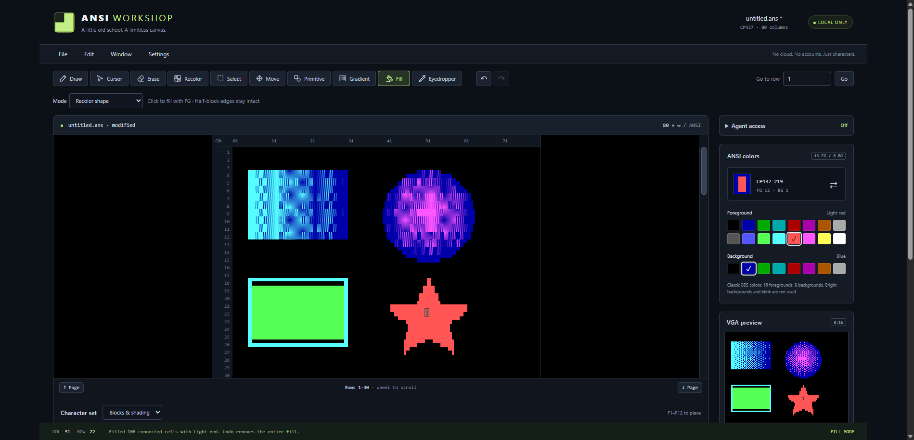
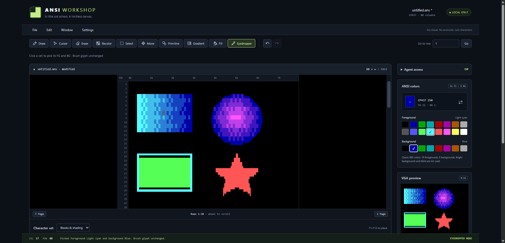
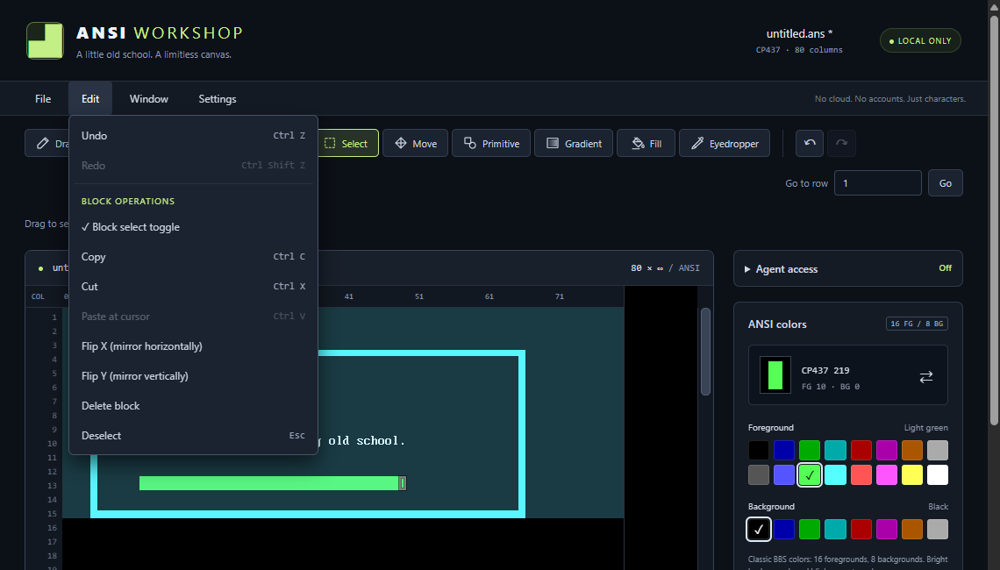
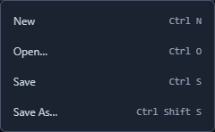

# Using ANSI Workshop

ANSI Workshop makes old-school ANSI art from **CP437 characters** and classic
BBS colors. Each cell holds a character, a foreground color, and a background
color. The canvas defaults to **80 columns wide**, with no configured row limit.
**Settings > New/Open columns** chooses 1-512 columns for the next document,
never resizes current art, and is overridden by valid SAUCE widths on Open.
It includes an experimental canned-transition mode, not a timeline or a full
terminal emulator.

**Save regularly. There is no autosave or recovery storage.** Art, undo history,
and the internal clipboard disappear when you close or reload the page.

## Contents

- [Get started](#get-started)
- [Meet the workspace](#meet-the-workspace)
- [Make your first drawing](#make-your-first-drawing)
- [Characters and colors](#characters-and-colors)
- [Drawing tools](#drawing-tools)
  - [Primitive tool](#primitive-tool)
  - [Path tool](#path-tool)
  - [Gradient tool](#gradient-tool)
  - [Fill tool](#fill-tool)
  - [Eyedropper tool](#eyedropper-tool)
- [Select, copy, and transform blocks](#select-copy-and-transform-blocks)
- [Navigate and adjust the display](#navigate-and-adjust-the-display)
- [Keyboard reference](#keyboard-reference)
- [Open and save artwork](#open-and-save-artwork)
- [Try experimental Ansimation](#try-experimental-ansimation)
- [Troubleshooting](#troubleshooting)
- [Optional agent access](#optional-agent-access)

## Get started

If someone has already started the app, open its local URL in your browser.
For native file opening and saving, use **standalone Chrome or Edge**.

To run it yourself, install Node.js 24+ and npm, open a terminal in the project
folder, and run:

```powershell
npm ci
npm run dev
```

Open **http://127.0.0.1:5173** and keep the terminal running. Keep the server
local; do not expose it to your network or through a tunnel.
See the [README](../README.md#run-locally) for production preview and static
hosting instructions.

Editing happens in the browser. There are no accounts, uploads, or automatic
cloud saves. A hosted copy still edits locally in your browser; native file
pickers require a supported browser and secure context.

## Meet the workspace



- **File, Edit, Window, Settings:** document commands, block operations, preview,
  and display preferences. Click a heading to open a menu; with one open,
  hover another heading to switch.
- **Tool buttons and options:** choose what a canvas click or drag does.
  Shape, gradient, and fill options appear below the tool buttons.
- **Screen editor:** the main drawing area. The ruler shows columns and the
  gutter shows rows. There is no grid overlay.
- **Character set:** below the canvas, choose a function-key palette or expand
  **All characters** to select a mouse brush.
- **ANSI colors:** choose foreground (FG) and background (BG); the sample shows
  your current character and colors.
- **VGA preview:** a live thumbnail in classic cell proportions, showing
  60 rows from the main view's top row, not the entire document.
- **Bottom status bar:** cursor position, feedback, and active tool.
  Coordinates start at column 1, row 1. An asterisk beside the filename and
  the word **modified** indicate unsaved changes.

Screenshots show a demonstration drawing. Your new document starts blank.
Panels may wrap or require page scrolling in a smaller window.

## Make your first drawing

1. Choose **Foreground Light cyan** and **Background Black** in ANSI colors.
2. Choose **Primitive**, then **Draw**, **Rectangle**, and **Outline**.
   Drag from near column 5, row 4 to column 66, row 15; release to place a border.
3. Choose **Cursor** and click inside the border. Choose **Foreground Yellow**
   and type `WELCOME TO ANSI WORKSHOP`. Typing places characters and advances
   the cursor; it does not insert or shift existing text.
4. Choose **Draw**, select the **F4** tile in **Blocks & shading**, and choose
   **Foreground Light green**. Drag a horizontal stroke below the text.
   Clicking the F4 tile selects a brush; pressing F4 while the canvas is focused
   places a character immediately.
5. Try **Ctrl+Z** to undo the stroke and **Ctrl+Shift+Z** to restore it.
6. Choose **File > Save As** and save an `.ans` file. Read
   [Open and save artwork](#open-and-save-artwork) for your browser's save mode.

To type without accidentally painting, use **Cursor**, or hold **Alt** while
clicking with any tool. Cursor-only clicks clear a selection but do not edit art.

## Characters and colors



### Pick a character

The **Character set** selector changes the F-key mappings. **Single lines**,
**Double lines**, and **Mixed lines** are useful for boxes and borders.
**All characters** offers every supported byte from 32 through 255, including
ASCII letters, shading, box lines, and extended CP437 symbols.

The default **Blocks & shading** palette uses:

| Key | Character | CP437 byte |
| --- | --- | --- |
| F1 | Light shade | 176 |
| F2 | Medium shade | 177 |
| F3 | Dark shade | 178 |
| F4 | Full block | 219 |
| F5 | Upper half block | 223 |
| F6 | Lower half block | 220 |
| F7 | Left half block | 221 |
| F8 | Right half block | 222 |
| F9 | Square | 254 |
| F10 | Middle dot | 250 |

F11 and F12 are unassigned in this palette. Other palettes can assign them.
Some keyboards require **Fn** for F-keys; browsers or operating systems may
reserve certain keys. Use the clickable tiles if a key is unavailable.

Typed text must be representable in CP437. Emoji and arbitrary Unicode are not
supported. Control bytes are not available as drawing characters.

### Pick colors

Classic ANSI has **16 foregrounds** and **eight backgrounds**, with no bright
backgrounds or blink. Before New/Open, choose **Settings > New/Open ANSI mode >
iCE Colors** for 16 backgrounds. SAUCE's iCE flag automatically selects the mode;
files without metadata use this setting. iCE treats SGR 5 as steady background
intensity, not animated blink. iCE imports also accept explicit bright
background codes (SGR 100-107); saves use SGR 5/25 with base background codes.
Swapping and Ctrl+arrows use all 16 backgrounds
in this mode. Use an iCE-compatible viewer; ordinary terminals may blink.
Colors affect new characters and drawing; picking a
color alone does not recolor existing art.

- **Ctrl+Left/Right** cycles foreground colors while the canvas is focused.
- **Ctrl+Up/Down** cycles background colors.
- **Swap foreground and background** exchanges the two. A bright foreground
  becomes its base color when moved to the background: Yellow becomes Brown,
  for example. The app reports this change.
- **Eyedropper** samples both colors from an existing cell, without changing
  your brush character.

A space can carry a visible background color. Such colored spaces are artwork,
not the default empty cells removed by Erase.

## Drawing tools

The main canvas mouse cursor matches the selected tool's icon. Its small
crosshair marks the exact click point, with black/white strokes visible over
light or dark art. The typing cursor and VGA preview navigation are unchanged.

| Tool | How to use it |
| --- | --- |
| Draw | Full Block paints the selected character and both colors; Half Block draws at upper/lower half-row resolution. |
| Cursor | Click to position the typing cursor without painting. |
| Erase | Click or drag to restore default blank cells. |
| Recolor | Drag over existing art to change both colors while keeping its characters. Default blank cells are skipped. |
| Select | Drag a rectangular block for copy, cut, paste, flip, or delete. |
| Move | Drag a painted cell to move its side-connected shape, regardless of glyph or color. |
| Primitive | Drag a rectangle, ellipse, rounded rectangle, or star, filled or outlined. |
| Path | Build an editable Bezier outline, then Finish to fill it or subtract it from existing art. |
| Gradient | Drag a linear or radial gradient across a matching shape or enclosed blank area. |
| Fill | Click to recolor a matching shape or fill an enclosed blank area. |
| Eyedropper | Click once to sample foreground and background colors. Dragging does not sample more cells. |

Each drawing stroke or completed shape/block action is one undo step.

### Draw modes

Choose **Draw**, then use its **Mode** selector:

- **Full Block** (default) keeps the original selected-character drawing.
  Selecting a shading, text, or half-block palette tile still paints that glyph.
- **Half Block** uses one-column-wide, half-row-high pixels. Click near the top
  or bottom of a cell to paint its upper or lower half (F5/F6). This mode never
  chooses F7/F8 left/right blocks or changes behavior based on stroke slope.
  The selected brush character is ignored; selected FG/BG colors are used.
  Painting both halves with matching FG/BG merges them into a full block,
  and retracing keeps it full. Different colors or other glyphs are replaced
  with the new half block and selected background, rather than mixed.

Skipped pointer positions are interpolated. Release places the final half-row
position; cancellation or lost capture commits the painted portion as one undo
step, just like ordinary Draw. Typing, F-keys, Alt+click, and preview navigation
are unchanged. The mode survives tool switches and New/Open, but not reload.

### Primitive tool

Use **Primitive** to draw geometric shapes without placing individual blocks.
The following practice drawing is also used in the Gradient, Fill, and
Eyedropper walkthroughs. Start on a blank document with **Background Black**.



1. Choose **Primitive**. Set **Mode > Draw**, **Shape > Rectangle**, and
   **Style > Filled**.
2. Choose **Foreground Light cyan**. Drag from column 5, row 4 to column 30,
   row 12. Release to place the solid rectangle.
3. Choose **Foreground Light magenta** and **Shape > Circle / ellipse**.
   Keep **Filled** selected. Drag from column 40, row 4 to column 63, row 15.
   Release to place the circle.
4. Choose **Foreground Light cyan**, **Shape > Rectangle**, and
   **Style > Outline**. Drag from column 5, row 18 to column 30, row 26.
   This closed border will be useful for enclosed Fill.
5. Choose **Foreground Yellow**, **Shape > Star**, and **Style > Filled**.
   Drag from column 40, row 18 to column 63, row 28.

The screenshot shows the completed shapes, with Star still selected.
The same workflow works with **Rounded rectangle**.

| Option | What it does |
| --- | --- |
| Mode: Draw | Adds the shape in the foreground/background colors selected when the drag starts. |
| Mode: Subtract | Cuts the shape out of existing art instead of adding it. |
| Shape | Selects Rectangle, Circle / ellipse, Rounded rectangle, or Star. |
| Style: Filled | Covers the interior of the shape. |
| Style: Outline | Draws only the border; the interior leaves existing art untouched. |

Shapes use full and half blocks automatically, not the selected brush glyph.
A live preview appears on the main canvas and VGA preview during the drag.
Release to commit the entire shape as one undo step.

#### Rotate or cancel a shape

To rotate, start dragging first, then hold **Alt** and move horizontally.
Sizing pauses while Alt is held; release Alt to resume sizing.
Moving one screen pixel horizontally rotates by one degree.
Do not hold Alt before starting: Alt+click only positions the cursor.
For an unrotated circle, use twice as many columns as rows because VGA cells
are twice as tall as they are wide.

**Escape**, focus loss, or pointer cancellation discards a primitive preview
without changing the document. **Ctrl+Z** removes a shape already placed.

#### Cut with Subtract

To try a cut, choose **Mode > Subtract**, **Shape > Circle / ellipse**, and
**Style > Filled**, then drag across part of the solid rectangle.
Release to remove the covered area. Use **Ctrl+Z** to restore the rectangle
before continuing with the Gradient walkthrough.

In **Subtract** mode, the preview shows the cut shape; releasing removes that
area from existing art. The preview color does not become the result's color.
Full-cell cuts erase cells; representable half-cell remnants retain their
original visible colors. Quarter-block remnants and partially cut text or
shading cannot be represented exactly and are cleared completely.
With **Outline**, only the outline is cut away, not the interior.

### Path tool

1. Choose **Path**, then **Mode > Fill** or **Subtract**.
2. Click to add corner nodes. Click-drag when adding a node to create a smooth
   curve with mirrored incoming/outgoing handles.
3. Add at least three nodes. Click the first node or **Close path** to close
   the outline without placing any art.
4. Drag square nodes to move them and their handles. Drag circular handles
   individually to reshape curves, even after closing. **Reopen path** lets
   you append more nodes.
5. Choose FG/BG while reviewing the closed path's live block preview.
6. Click **Finish path** or press **Enter** with a canvas focused to apply the
   whole path as one undo step. Finish also closes an open outline.

**Escape** or **Cancel path** discards the draft without changing art/history.
Switching tools also discards it. Pointer cancellation/focus loss rolls back
only the current node/handle drag; the rest of the draft remains editable.
Typing, F-keys, undo/redo and block edits pause while a draft exists. Tab still
reaches controls; ordinary keyboard editing resumes after Finish or Cancel.
New/Open asks before discarding a draft, and reload warns about it.

#### Delete or convert nodes

Click a square node or its handle, or choose it from **Node**, to select it.
The selected square is filled green with a white border.

- **Delete node**, **Delete**, or **Backspace** removes the selected node.
  A closed path stays closed if at least three nodes remain. Fewer nodes
  reopen it; deleting the last node clears the draft.
- **Make curve** gives a corner smooth mirrored handles, oriented using its
  neighbors. Drag either handle afterward to customize the curve.
- **Make corner** collapses both handles to the anchor, making straight
  segments at that node unless the adjacent nodes still have curve handles.
  The anchor itself does not move.

All these changes remain draft-only, including on closed paths. Finish commits
only the final block result, not separate node-edit undo steps.

Fill uses the current FG/BG, not the brush glyph. Paths are sampled in VGA's
1:2 proportions and fitted to full, upper/lower and left/right half blocks.
Tiny slivers can be omitted; CP437 has no arbitrary curved or quarter blocks.
Self-intersecting paths use even-odd filling (crossing an edge toggles inside).

Subtract replaces covered pixels with the current **BG**. Surviving full/half
blocks keep their visible colors wherever representable. Clipped text and
shading use the bundled IBM VGA bitmap to find the closest block approximation,
even with Consolas selected. A cell can retain only one surviving color plus
the hole BG, so multi-color remnants are approximate. Blank cells outside
existing art are not added by subtraction.

The main canvas shows the editable outline, nodes and handles; both canvases
show the closed path's resulting block preview. Only finished paths become
ordinary editable cells. Paths are not retained as vector objects after Finish,
and unfinished drafts are not included in saves/exports.

### Gradient tool

Use **Gradient** to shade an existing connected shape or an enclosed blank area
between two colors. Unenclosed blank space is rejected. Start with the filled rectangle
and circle from the Primitive walkthrough.

#### Linear: shade from one side to the other



1. Choose **Foreground Light cyan** and **Background Blue**. These are the
   gradient's start and end colors, respectively.
2. Choose **Gradient**, then **Type > Linear**.
3. Start on the rectangle at column 5, row 8. Drag horizontally to column 30,
   row 8, keeping the pointer held down to see the preview.
4. Release to apply. The rectangle fades from cyan on the left toward blue on
   the right; the other shapes remain unchanged.

The screenshot shows the live preview before release. The drag line controls
the transition direction and length, not a rectangular selection.
Try a vertical or diagonal drag for a different direction.
The whole matching region is shaded: cells beyond the line's endpoints use
the corresponding endpoint color.

#### Radial: shade outward from a center



1. Choose **Foreground Light magenta**, keeping **Background Blue**.
2. Set **Type > Radial**.
3. Start near the circle's center at column 51, row 9. Drag horizontally to
   column 63, row 9.
4. Release to apply. The start point is the center; the drag length is the
   radius at which the background endpoint color is reached.

Both modes use block shading and dithering between the endpoint colors.
Half-block edges retain their character and original background to preserve
the silhouette. Gradients follow classic VGA proportions.

**Escape**, focus loss, or pointer cancellation discards the live preview.
Each completed gradient is one undo step; a click without a drag changes nothing.

#### Which cells receive a gradient?

The tool follows side-connected cells matching the starting cell's existing
foreground/background colors, not the colors you just selected for the brush.
Blocks, half blocks, and shading form one character family; other characters
must match exactly. Different colors, disconnected artwork, and diagonal-only
contact stop the region.

For predictable results, start with a uniformly colored filled primitive.
Applying another gradient to an already shaded shape may affect only part of
it because its cells now have different colors.

#### Shade an enclosed blank area

Choose Linear or Radial and drag from a default blank cell inside a closed
outline. The whole connected interior receives the gradient; the outline and
unrelated art stay unchanged. The drag direction/radius, live preview, cancellation,
and single-step undo work just as they do for filled shapes.

This uses the same enclosure rules as **Fill enclosed blank area**, including
connected black background halves of half-block edges. Those blank halves use
the nearer endpoint color, preserving the outline ink (sometimes reversing the
glyph/inks). Colored spaces and nonblack backgrounds remain barriers. An area
that reaches the top/side edges or a completely empty row fails without changes.
Classic ANSI cannot retain two different bright inks in one half-block cell;
choose a nonbright foreground endpoint or use an iCE document if this occurs.

### Fill tool

**Fill** has two distinct modes. Both use the selected **foreground** color,
not the brush character or selected background, and one click is one undo step.
Dragging does not fill additional regions.

#### Fill enclosed blank area



1. Choose **Fill**, then **Mode > Fill enclosed blank area**.
2. Choose **Foreground Light green**.
3. Click the blank interior of the outlined rectangle at column 17, row 22.
4. The interior becomes solid green full blocks. The cyan border, gradients,
   and yellow star remain unchanged.

The screenshot keeps **Background Blue** selected from the Gradient walkthrough;
the fill still uses green full blocks rather than painting blue backgrounds.

This mode paints default blank cells inside a closed outline, including connected
black background halves of upper/lower/left/right half blocks. It preserves the
painted outline and its colors; matching fill and outline colors become full
blocks. Colored spaces, nonblack backgrounds, and other glyphs remain barriers.
Classic ANSI cannot retain two different bright colors in one half-block cell:
choose a nonbright fill color or use an iCE document if that error appears.
An opening through a blank half to the
canvas's top or side edges, or an entirely empty row, means the area is not
enclosed. The app reports an error and changes nothing; close the gap and retry.

#### Recolor shape



1. Set **Mode > Recolor shape**.
2. Choose **Foreground Light red**.
3. Click a painted cell inside the yellow star at column 51, row 22.
4. The connected star becomes light red without changing the surrounding art.

This mode uses the same color and character-family matching as Gradient.
It makes shading solid, but retains half-block and text characters and existing
backgrounds. Different existing colors or disconnected pieces stop the fill.
On multicolored art, repeat clicks on the separate matching regions as needed.

Choose **Recolor** instead if you want to brush both foreground and background
over existing cells while keeping all their characters, including shading.

Use **Ctrl+Z** to undo either kind of fill.

### Eyedropper tool

Use **Eyedropper** to reuse colors from your drawing without guessing which
swatches they use. It samples both foreground and background, **not** the
character.



1. For this example, click the **F10** tile in **Blocks & shading** to choose
   the middle-dot brush (CP437 250).
2. Choose **Foreground Yellow** and **Background Red** so the change is obvious.
3. Choose **Eyedropper** and click near the middle of the linear gradient,
   at column 17, row 8.
4. Check **ANSI colors** and the status bar: the selected colors become
   **Light cyan / Blue** (FG 11 / BG 1), while the brush remains **CP437 250**.
5. Switch to **Draw** to paint dots using the sampled colors, or choose another
   drawing tool to reuse them.

The screenshot shows the result of sampling, before any new painting.
The art and modified state do not change, and sampling adds no undo step.
Eyedropper stays active until you choose another tool; each click samples once,
and dragging does not continuously sample.

Clicking a default blank picks **Light gray / Black**. **Alt+click** only
positions the cursor, even with Eyedropper active. Clicking the VGA preview
also positions the cursor rather than sampling; sample on the main canvas.

### Move a shape

**Move** follows all side-connected painted cells, including colored spaces;
diagonal-only contact does not connect shapes. It ignores glyph/color differences.
The preview stops at the canvas boundaries instead of clipping the shape.
Release to place it, or Escape to cancel. Only the shape's destination cells
overwrite art; holes stay untouched. Undo restores both the source and any
overwritten destination art.

## Select, copy, and transform blocks



1. Choose **Select** and drag around the desired area, or use **Shift+arrows**
   from the canvas cursor.
2. Choose **Edit > Copy** or **Cut**.
3. Choose **Cursor** and click the intended destination. This is the pasted
   block's top-left corner.
4. Choose **Edit > Paste at cursor**.

**Paste is opaque:** blank cells in the copied rectangle erase destination art.
Pasting clips at column 80. The clipboard belongs to this browser page, not the
operating-system clipboard; it is not a way to copy text to another app.

With a selection active, use **Flip X (mirror horizontally)** or
**Flip Y (mirror vertically)**. Recognized directional characters are mirrored
along with their positions. **Delete block** clears the rectangle;
**Deselect** leaves the art unchanged.

To select beyond the visible rows, keep dragging above or below the canvas.
The view scrolls automatically; moving farther outside scrolls faster.
The VGA preview also supports drag-to-select, regardless of the active tool.

## Navigate and adjust the display

- Use the mouse wheel, page buttons, or scrollbar beside the canvas to browse
  rows without moving the typing cursor.
- Enter a **one-based** number in **Go to row** and choose **Go**.
- The scrollbar covers painted rows plus extra blank pages and expands as you
  explore farther. Its bottom is not a document length limit.
- Use **Window > Hide/Show VGA Preview** to toggle the thumbnail.
  Click the preview to move the cursor without painting; drag to select.
  Focus it to wheel-scroll both viewports, or use the scrollbar beside it.
  Preview scrollbar track clicks and Page Up/Down move by 60 rows without
  moving the cursor or editing art. Live shape placement pauses scrolling.
  It supports canvas keyboard shortcuts too.
- In **Settings**, independently choose **IBM VGA 8x16** or **Consolas**, and
  **Pixel perfect (8x16)**, **1.25x (10x20)**, or **2x (16x32)** cell size.
  Display changes do not modify the document or its saved state.
  **Character width** chooses native 8px or 9px independently of zoom.
  IBM 9px rendering preserves the original glyph and repeats its eighth pixel
  in the ninth column for CP437 192-223 only; other ninth columns are blank.
  Preview and glyph samples follow this setting. Consolas fits the wider cell.

The IBM bitmap is the default classic appearance. Consolas depends on installed
fonts and can look different across computers. The 1.25x bitmap enlargement has
uneven pixel widths; native size and 2x use whole-pixel enlargement.
Browser zoom and display scaling can still change the on-screen appearance.

At 2x, smaller windows may need horizontal scrolling and page scrolling to
reach lower controls. The canvas does not shrink characters to fit.
Display settings survive New/Open but reset on reload.

## Keyboard reference

**Focus the canvas or VGA preview first.** Click with Cursor or Alt+click if
you do not want to paint. Shortcuts do not take over normal typing in form
fields, select controls, or dialogs. On macOS, **Cmd** can replace **Ctrl**.

| Shortcut | Action |
| --- | --- |
| Arrow keys | Move one cell |
| Home / End | Move to column 1 / 80 on the current row |
| Page Up / Page Down | Move the cursor by a visible page |
| Enter | Move to column 1 on the next row |
| Printable CP437 text | Write at the cursor and advance |
| F1-F12 | Place the mapped palette character and advance |
| Backspace | Move left and erase; does not join lines |
| Delete | Erase at the cursor |
| Backspace / Delete with a selection | Clear the selected block |
| Shift+arrows | Extend a selection |
| Ctrl+A | Select all document columns through the last nondefault row |
| Ctrl+C / X / V | Copy / cut / paste a block |
| Ctrl+Left / Right | Cycle foreground backward / forward |
| Ctrl+Up / Down | Cycle background backward / forward |
| Ctrl+Z | Undo |
| Ctrl+Shift+Z or Ctrl+Y | Redo |
| Ctrl+N | New document |
| Ctrl+O | Open a local file |
| Ctrl+S | Save |
| Ctrl+Shift+S | Save As |
| Escape | Deselect and return to Draw; cancel a shape/gradient/move preview |

Undo/redo also works from tool buttons and menus, except when a form control or
dialog needs native keyboard behavior. During primitive, gradient, and move
placement, other canvas shortcuts and wheel scrolling pause.

## Open and save artwork



### Open an existing file

For RGB art, choose **File > New TundraDraw…**, or Open a `.tnd` file.
TundraDraw uses **24-bit RGB** foregrounds and backgrounds with the same
document-width CP437 drawing tools. Its sidebar has RGB pickers, 16 color presets
for each ink, and a compact swatch grid. **User Defined** contains optional named
swatches (Save FG/BG swatch); **Currently Used** follows the current drawing
and undo/redo, with 64 colors per page. Hover, keyboard-focus, or click a swatch
to see its name and FG/BG buttons. User-defined swatches also offer Remove.
Use arrow keys to switch the tabs, Tab to reach swatches/actions, and Escape to
close a swatch's actions.
Up to 64 named swatches stay in memory only; New/Open/reload clears them and
they are not stored in `.tnd`. Normal Save/Save As writes TundraDraw bytes,
including optional SAUCE metadata. Ctrl+arrows cycle presets.
Agent access and Ansimation remain 80-column classic ANSI only.
New/Ctrl+N retains TundraDraw; otherwise it uses New/Open ANSI mode.
**New ANSI…** uses the selected ANSI mode without
converting existing artwork. See [TundraDraw compatibility](../README.md#tundradraw-24-bit-rgb)
for supported records and the format's 32-bit row boundary.

Choose **File > Open** and select a local `.ans` file. Opening warns before
replacing unsaved art. Cancellation or an invalid file leaves the current
document intact; long reads can be canceled.

A successful open resets cursor position, view, selection, and undo/redo history.
It also disconnects agent access. The opened document starts unmodified.
Files are read in the browser, not uploaded.

This editor reads static CP437 ANSI art with 1-512 columns, not UTF-8 text or every ANSI
terminal feature. Animated blink, extended bright backgrounds, truecolor, and unsupported
controls produce visible errors. Supported static SAUCE metadata is preserved
on normal ANSI saves; font/display hints do not change canvas settings.
See [file compatibility](../README.md#open-saved-ansi-files) for the exact limits.

### View or edit SAUCE metadata

Choose **File > SAUCE…** to view or edit the title, author, group, date, and
comments. Files without metadata show an empty draft; **Apply** adds a SAUCE00
record. **Cancel** or Escape discards the draft. **Remove SAUCE** removes the
record. Apply/removal is one undoable document edit and marks the file modified;
save normally to write the change. New starts without metadata.
For iCE or non-80-column documents, saving still includes a minimal SAUCE record
for mode/width after removing descriptive metadata. ASCII copies omit these hints.

Text uses CP437: title allows 35 bytes, author/group 20 each, and comments up to
255 lines of 64 bytes. Enter a real date as YYYYMMDD, or leave it blank.
Unsupported characters, invalid dates, and overlong fields show an error without
changing the document. Read-only format information shows the preserved font
and display hints. ANSI save recomputes size/dimensions; heights over 65,535 rows
are unspecified rather than truncating artwork. Metadata-bearing ANSI content
must fit SAUCE's 32-bit file-size field; removing SAUCE permits larger output
only for classic 80-column documents.

### Choose the right save mode

Choose **File > Save As ASCII…** for a separate `.asc` copy without ANSI
escape codes or colors. It preserves blocks, shading, and box drawing as raw
CP437 bytes, not UTF-8 or strict 7-bit ASCII. Use a CP437-aware text viewer.
The copy leaves the document name, normal ANSI Save destination, and modified
indicator unchanged; use normal Save as well to keep your colored artwork.
ASCII and animation copies do not include SAUCE metadata.

| Browser / mode | What Save does |
| --- | --- |
| Standalone Chrome/Edge with native picker support | First Save asks for a destination; later Save writes to the same authorized file. Save As chooses a new destination. |
| Download mode, including the VS Code integrated browser | Requests an `.ans` or `.tnd` download for the current document format (or `.asc` for Save As ASCII). Your browser controls its destination and whether to ask where to save. |

If opened with a native picker, **Save** targets that file, subject to write
permission. File-input opening is read-only: Save asks for a destination where
native saving is supported, or requests a download.

**A requested download is not confirmation that a file reached disk.**
Check your browser's downloads and destination folder yourself. Download mode
does not clear the modified indicator and refuses output larger than **64 MiB**.
Use standalone Chrome/Edge's native Save As for larger streamed output.
There is no automatic fallback that hides a failed native write.

Native saves report cancellation and permission/disk errors. For a long save,
use the app's cancellation control if needed. If you edit during a native save,
only the captured version becomes saved; newer edits remain modified.
Do not close the page while saving.

### Share and view the result

Files contain binary **CP437**, ANSI colors, and CRLF newlines, not UTF-8.
Use an ANSI viewer configured for CP437 and the **document's column count**
(and iCE mode when applicable); a generic text
editor may show escape codes or incorrect characters.
Default trailing empty cells and rows are omitted; colored spaces are retained.
Test the output on your intended BBS or viewer, especially older terminals'
bright-foreground support. The live preview is not a full terminal simulation.

Before **File > New**, reload, or closing, save anything you want to keep.
Warnings reduce accidental loss but are not a recovery system.
Switching to another browser does not transfer the current art; save it first,
then open the file in the other browser.

## Try experimental Ansimation

1. Draw or open your first art, and scroll to the section you want to animate.
2. Choose **Window > Ansimation (experimental)**. The panel copies an **80x25**
   screen starting at the current top row. Longer art is cropped, not resized.
3. Pick **Effect**: wipe, cross-dissolve, flame, eraser down/across, spotlight,
   Venetian blinds, iris reveal, digital rain, Neo, bullet holes, checkerboard, text spinner,
   or text slide.
4. For a transition between two arts, choose **Load second ANSI**. Its first 25
   rows become the second layer. **Use single ANSI** returns to one-art effects.
   With a single art, flame/erasers/bullet holes remove it; the other general effects reveal it.
   Text effects use the current art only; a loaded second art remains available
   when switching back to another effect.
5. Choose **Preview speed**: 2.4k, 9.6k, 14.4k (default), 28.8k, 56k, or 115.2k.
   **Frame detail** chooses 13, 37, or 73 steps for general transitions. Text
   effects generate all letter steps automatically instead. Bullet holes also
   uses automatic steps so each burst clears before the next impact. More steps can take
   longer to transmit. **Play**, **Stop**, and **Replay** need no timeline.
6. **Export ANSI** saves a separate `.ans` animation copy. Save your original
   artwork separately: exporting a transition never marks the editor saved.

Preview transmits the exported ANSI bytes, so you see partial character updates,
not merely delayed screenshots. It approximates serial 8N1 (ten bits per byte);
actual modem compression, buffering, and BBS output behavior can differ. Playback
pauses in hidden tabs. Effects retain CP437 glyphs and DOS colors; cross-dissolve
is a scattered cell dissolve, not smooth RGB blending.

**Neo** reveals the art behind sparse falling, flickering light/dark green ASCII
letters and numbers, with at most 20 rain columns across the screen.
**Bullet holes** punches differently sized circles through the art, with blocks
quickly flying outward, shrinking, and clearing before the next circle is removed.
The holes remain open and eventually cover the whole screen. With a single art
they reveal blank space; with two they reveal the next art underneath.
**Text spinner** reveals each ASCII letter/digit after repeating the exact
sequence `|/-\|/-\|` three times. **Text slide** brings each letter from the right edge to
its original position. Both text effects proceed top-to-bottom, left-to-right,
and keep punctuation, borders, shading, and accented/Greek glyphs fixed.
Sliding letters can temporarily occupy blank spaces or unrevealed text, but
hide behind decorative glyphs; background colors remain unchanged.
All original text/colors are restored at the end. If no ASCII letters/digits
are present, the panel explains that there is nothing to animate.
Try lower modem speeds to make the spinner and sliding motion easier to see.

**Plain .ans has no portable frame delays.** The selected preview speed is not
stored in the download. Configure your BBS/player's output speed and an **80x25,
CP437** screen; a fast viewer may show only the final art. Cursor-addressed
updates avoid bottom-row newlines, but check your intended terminal. Reopening
an exported animation here loads the final screen, not an editable animation.
There is no video export, automatic looping, autosave, or recovery.

Closing the panel cancels its work and returns to the unchanged editor.
Sources/settings disappear when the panel closes; keep original files.
Native export errors/cancellation remain visible, and download delivery cannot
be verified by the editor.

## Troubleshooting

| Problem | What to try |
| --- | --- |
| Typing or shortcuts do nothing | Focus the canvas with Cursor or Alt+click. Finish/cancel any shape drag. |
| An F-key opens browser/OS UI | Use Fn if required, or select its palette tile and draw. |
| Clicking paints when you only want to type | Choose Cursor, Alt+click, or click the VGA preview. |
| A gradient/fill misses part of the art | Check side connections and matching colors/glyphs; diagonal contact is not enough. |
| Enclosed fill is rejected | Close the outline; check for gaps, empty rows, or contact with the canvas edges. |
| Pasting erases nearby art | The whole copied rectangle, including blanks, is opaque. Undo and choose a safer destination. |
| Save keeps the modified indicator | In download mode this is intentional. Verify the download; newer edits during native saving also remain modified. |
| Native files cannot be read/written in VS Code | Use standalone Chrome/Edge at the same URL. Save before switching. |
| An opened file has wrong characters or is rejected | Check CP437, New/Open width/mode (or SAUCE hints), and supported ANSI attributes. UTF-8 and ANSI truecolor art are not supported. |
| Controls or columns are off-screen | Scroll horizontally inside the editor or scroll the page; try a smaller cell size in Settings. |

Read the status bar and any **Something needs attention** message for details.
Error messages stay pinned immediately above the status footer, visible without
scrolling the page. Use **Dismiss error** to close the message.
Canceling an open or save does not recover art lost from a previous page session.
No configured row cap does not mean infinite resources: memory, undo history,
export time, disk space, and representable coordinate precision still matter.

## Optional agent access

You can use the editor without agents; access is **Off** by default.
If you want an approved local MCP client to read and draw on the current
document, follow the separate [agent setup guide](./MCP.md).

Never give an agent the owner's bootstrap key. Issue a separate, expiring token
for each approved agent, and revoke access when finished.
Approved agents can read and overwrite art; consider their provider's data
handling before approving them. Drawing is undoable and agents cannot save
files. Agent access is supported only from the local editor, not a hosted copy.

### Screenshot and font credits

**Help > About ANSI Workshop** shows version **0.1**, links to the
[GitHub project](https://github.com/wood-commits/ansi-workshop) and
[hosted static editor](https://wood-commits.github.io/ansi-workshop/), the full
MIT editor license, and the complete font license and notices.
Close or Escape dismisses the dialog and returns keyboard focus to Help.
Opening About does not change artwork, undo history, or the document's saved state.

Screenshots in this guide show artwork created in ANSI Workshop for this guide,
using its bundled IBM VGA bitmap. The font is derived from Web437 IBM VGA 8x16
by [VileR](https://int10h.org/oldschool-pc-fonts/), licensed under
[CC BY-SA 4.0](https://creativecommons.org/licenses/by-sa/4.0/).
See the bundled [font notices](../src/assets/fonts/NOTICE.txt) and
[full license](../src/assets/fonts/LICENSE.txt), also available in
**Settings > IBM font license and notices**.
